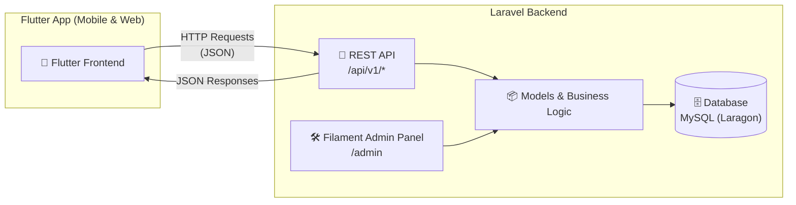

# 📋 Rencana Aksi: Aplikasi CMS & Pertanyaan Masyarakat

> Aplikasi Laravel 13 + Filament v5.11 sebagai backend (Admin Panel + REST API) untuk mengelola konten profil instansi dan menerima pertanyaan dari masyarakat. Frontend publik akan dibangun terpisah menggunakan **Flutter**.

---

## 🗂️ Entity Relationship Diagram (ERD)

---

## 🏛️ Arsitektur Sistem (API-First)

---

## 🏗️ Arsitektur Modul

### Modul 1: CMS (Content Management System)

| Fitur | Deskripsi | Status |
|-------|-----------|--------|
| **Manajemen Post/Artikel** | CRUD artikel dengan kategori, gambar unggulan, status draft/publish/archived, rich text editor | ✅ Selesai |
| **Manajemen Halaman Statis** | Halaman seperti "Tentang Kami", "Visi Misi", "Struktur Organisasi" | ✅ Selesai |
| **Manajemen Kategori** | Pengelompokan artikel berdasarkan kategori dengan slug otomatis | ✅ Selesai |
| **Manajemen Media** | Upload & kelola pustaka file/gambar | ✅ Selesai |
| **Manajemen Menu** | Menu navigasi dinamis untuk header, footer, sidebar dengan item bertingkat | ✅ Selesai |
| **Manajemen Slide** | Slide promosi di halaman utama dengan jadwal tayang aktif | ✅ Selesai |
| **Pengaturan Situs** | Nama instansi, logo, alamat, kontak, media sosial | ✅ Selesai |

### Modul 2: Pertanyaan Masyarakat

| Fitur | Deskripsi | Status |
|-------|-----------|--------|
| **Form Pertanyaan Publik** | REST API endpoint untuk masyarakat mengirim pertanyaan (dikonsumsi Flutter) dengan rate limiting | ✅ Selesai |
| **Topik Pertanyaan** | Kategori topik pertanyaan (pelayanan, administrasi, bansos, sarana publik) | ✅ Selesai |
| **Manajemen Pertanyaan** | Admin review, jawab, atau tolak pertanyaan masuk via Filament Resource | ✅ Selesai |
| **FAQ** | Kumpulan pertanyaan yang sering diajukan per topik | ✅ Selesai |
| **Notifikasi Email** | Notification class `QuestionAnsweredNotification` untuk mengirim email otomatis saat ditanggapi | ✅ Selesai |

---

## 📦 Tahapan Implementasi

### Fase 1: Fondasi & Konfigurasi ⏱️ ~2 hari

- [x] Install Laravel 13 + Filament v5
- [x] Konfigurasi database (`.env`)
- [x] Setup Filament Admin Panel (tema Teal, branding, navigasi terkelompok)
- [x] Konfigurasi role & permission pada model User (Admin, Editor, Viewer)
- [x] Buat migration untuk tabel `settings`
- [x] Buat `SettingResource` di Filament

### Fase 2: Modul CMS ⏱️ ~5 hari

- [x] **Kategori**
  - [x] Buat Model, Migration, Factory, Seeder
  - [x] Buat `CategoryResource` (Filament)
- [x] **Post/Artikel**
  - [x] Buat Model, Migration, Factory, Seeder
  - [x] Buat `PostResource` (Filament) dengan rich text editor
  - [x] Implementasi slug otomatis, featured image, status filter
- [x] **Halaman Statis**
  - [x] Buat Model, Migration, Factory, Seeder
  - [x] Buat `PageResource` (Filament)
- [x] **Media Library**
  - [x] Buat Model, Migration, Factory
  - [x] Buat `MediaResource` (Filament)
- [x] **Menu & Menu Items**
  - [x] Buat Model, Migration, Factory, Seeder
  - [x] Buat `MenuResource` dengan nested menu items (Repeater)
- [x] **Slide**
  - [x] Buat Model, Migration, Factory, Seeder
  - [x] Buat `SlideResource` (Filament)

### Fase 3: Modul Pertanyaan Masyarakat ⏱️ ~3 hari

- [x] **Topik Pertanyaan**
  - [x] Buat Model, Migration, Factory, Seeder
  - [x] Buat `QuestionTopicResource` (Filament)
- [x] **Pertanyaan**
  - [x] Buat Model, Migration, Factory, Seeder
  - [x] Buat `QuestionResource` (Filament) dengan filter status & badge count
  - [x] Implementasi validasi & rate limiting pada API (`throttle:10,1`)
- [x] **Jawaban Pertanyaan**
  - [x] Buat Model, Migration, Factory
  - [x] Integrasikan jawaban langsung di `QuestionResource` (Repeater riwayat jawaban)
  - [x] Kirim notifikasi email ke penanya (`QuestionAnsweredNotification`)
- [x] **FAQ**
  - [x] Buat Model, Migration, Factory, Seeder
  - [x] Buat `FaqResource` (Filament)

### Fase 4: REST API untuk Flutter ⏱️ ~4 hari

- [x] Install & konfigurasi Laravel Sanctum untuk autentikasi API
- [x] **API Publik (tanpa auth)**
  - [x] `GET /api/v1/posts` — Daftar artikel (pagination, filter kategori, search)
  - [x] `GET /api/v1/posts/{slug}` — Detail artikel (auto increment view_count)
  - [x] `GET /api/v1/pages` — Daftar halaman statis
  - [x] `GET /api/v1/pages/{slug}` — Detail halaman statis
  - [x] `GET /api/v1/categories` — Daftar kategori
  - [x] `GET /api/v1/categories/{slug}` — Detail kategori
  - [x] `GET /api/v1/slides` — Daftar slide aktif
  - [x] `GET /api/v1/menus` — Daftar semua menu aktif
  - [x] `GET /api/v1/menus/{location}` — Menu berdasarkan lokasi (header/footer/sidebar)
  - [x] `GET /api/v1/settings` — Pengaturan situs (nama, logo, kontak, medsos)
  - [x] `GET /api/v1/faqs` — Daftar FAQ (filter per topik & search)
  - [x] `GET /api/v1/question-topics` — Daftar topik pertanyaan
  - [x] `GET /api/v1/questions` — Daftar pertanyaan yang sudah dijawab (publik)
  - [x] `GET /api/v1/questions/{id}` — Detail pertanyaan dan jawaban publik
  - [x] `POST /api/v1/questions` — Kirim pertanyaan baru (validasi + rate limit)
- [x] Buat API Resource classes (`PostResource`, `SlideResource`, `MenuResource`, dll) untuk response formatting
- [x] Implementasi API versioning (`/api/v1/...`)
- [x] Dokumentasi API (Postman Collection: `docs/postman_collection.json`)
- [x] CORS configuration untuk akses dari Flutter (`config/cors.php`)

### Fase 5: Polish & Deployment ⏱️ ~2 hari

- [x] Dashboard widget (statistik artikel, pertanyaan masuk, list artikel & pertanyaan terbaru)
- [x] Testing (unit & feature tests: 15 tests, 186 assertions - 100% passing)
- [x] Formatter Laravel Pint diterapkan ke seluruh file baru
- [ ] Deployment ke server production / cloud

---

## 🔑 Kredensial Default (Testing / Seeder)

| Role | Email | Password | Panel URL |
|------|-------|----------|-----------|
| **Super Admin** | `admin@muslih.id` | `password` | `/admin` |
| **Editor** | `editor@muslih.id` | `password` | `/admin` |

---

## 🚀 Koleksi Postman untuk Frontend Flutter

File Postman Collection v2.1 tersedia di:
`docs/postman_collection.json`

Dapat langsung diimpor ke Postman / Insomnia / Thunder Client untuk pengujian dan integrasi dengan aplikasi Flutter.
